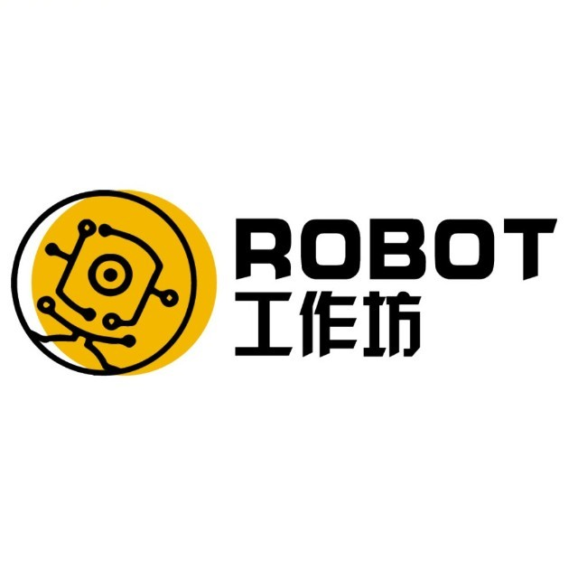

<div align="center">

<p align="center">
  
  
</p>

# RoboCup HSL 新人入门手册与知识图谱

**A Comprehensive Onboarding Handbook & Engineering Roadmap for RoboCup Humanoid Soccer League (HSL)**

[](https://github.com/RobotWorkShop-BigHeroX/RoboCupBook/releases)
[](https://robotworkshop-bigherox.github.io/RoboCupBook/)
[](https://www.python.org/downloads/)
[](LICENSE)
[](https://github.com/astral-sh/uv)
[](https://www.latex-project.org/)
[](https://hsl.robocup.org/qualified-teams/)
[](https://github.com/RobotWorkShop-BigHeroX)

*面向对于 RoboCup 及人形机器人足球联赛（HSL）完全不了解的新成员的系统入门手册*  
*湖南大学 Robot 工作坊 · BigHeroX 战队倾力打造*

**🌐 在线阅读站点：[https://robotworkshop-bigherox.github.io/RoboCupBook/](https://robotworkshop-bigherox.github.io/RoboCupBook/)**

*Powered by [uv](https://github.com/astral-sh/uv) package manager ⚡ and XeLaTeX Document Engine 📄*

</div>

---

## 📖 项目愿景与定位

本项目旨在建设一套面向完全不了解 RoboCup（机器人世界杯）及 HSL（Humanoid Soccer League，人形机器人足球联赛）的新成员的入门知识体系。

读者可能没有参加过 RoboCup，不了解人形机器人足球比赛，也可能没有深入使用过 ROS 2、Git 或机器人感知与控制算法。手册的目标不是让读者死记硬背所有技术细节，而是让读者快速建立完整的认知框架与工程思维：
1. **RoboCup 与 HSL 是什么**：赛事演进历史、合并重组脉络、核心规则与裁判盒（GameController）机制。
2. **本队技术栈与平台**：T4 机器人硬件参数、核心器件（IMU、足式里程计）、中联重科（Zvalley）开源生态及本队历年公开技术成果（TDP、资格赛视频）。
3. **技术进阶递进路线**：从 Git、ROS 2、Linux 工具，到 YOLO 视觉、行为树/状态机决策、粒子滤波全局定位，直至前沿深度强化学习。
4. **权威一手信息渠道**：赛事官方站点、Rules 仓库、必订邮件列表与 Discord 核心开发者社区。
5. **实验室至上安全守则**：吊机悬挂要求、防空转自锁规范、三人协作测试制、“进阻尼”肌肉记忆与复位 SOP。

---

## 📚 手册目录全景导航

| 章节模块 | 核心内容概述 | 在线查阅链接 |
| :--- | :--- | :---: |
| **01. RoboCup与HSL介绍** | 1.1 赛事历史演进（合并SPL/取消MSL） · 1.3 7人制核心规则 · 1.4 裁判盒（GameController） | [查阅章节](docs/01-robocup-hsl-introduction.md) |
| **02. 全球强队与开源资产** | 1.2 历史强队谱系（B-Human, Rhoban, NimbRo, 清华, 中农, RoMeLa等）与代码库解析 | [查阅章节](docs/02-teams-and-repositories.md) |
| **03. BigHeroX 机器人平台** | 2.1 T4 机器人硬件与关键器件（IMU/里程计） · 2.2 网站平台 · 2.3 Zvalley 生态 · 2.4 本队 TDP/视频 | [查阅章节](docs/03-bigherox-platform.md) |
| **04. 新成员技术学习路线** | 3.0 Git · 3.1 ROS 2 八大核心特性 · 3.2 Linux · 3.3 YOLO视觉 · 3.4 行为树 · 3.5 粒子滤波 · 3.6 DRL | [查阅章节](docs/04-learning-roadmap.md) |
| **05. 官方消息渠道汇总** | 4.1 官方入口 · 4.2 规则与工具仓库 · 4.3 核心实时渠道（必订邮件列表与 Discord） | [查阅章节](docs/05-information-channels.md) |
| **06. 实验室操作安全守则** | 5.1 吊机安全悬挂 · 5.2 三人协作测试制 · 5.3 紧急进阻尼肌肉记忆 · 5.4 开机复位规范 | [查阅章节](docs/06-safety-handbook.md) |

---

## 🔒 私有仓库与敏感资料说明（Submodule）

本手册项目采用**公开/私有分层架构**：
- **公开资料（`public-resource/`）**：存放本队公开 TDP 论文、通用比赛模板及公开多媒体图像。
- **私有资料（`Zvalley-resource-old/`）**：以 **Git Submodule** 形式独立接入内部私有仓库 [`RobotWorkShop-BigHeroX/robocup-zvalley-resource`](https://github.com/RobotWorkShop-BigHeroX/robocup-zvalley-resource)，托管 T4 机器人内部硬件手册等敏感资产。

### 克隆与拉取完整仓库
若你已获得战队内部授权，请在克隆主仓库时加入 `--recurse-submodules` 参数：
```bash
# 完整递归克隆（包含私有子模块）
git clone --recurse-submodules https://github.com/RobotWorkShop-BigHeroX/RoboCupBook.git

# 若之前已单独克隆，可通过如下命令初始化拉取子模块
git submodule update --init --recursive
```

---

## 🛠️ 本地编译与构建高规格标准 PDF

本项目参考国际官方 [RoboCup HSL Rules.tex](https://github.com/RoboCup-HumanoidSoccerLeague/HSL-Rules/blob/main/Rules.tex) 设计了高规格 LaTeX 排版工程，每页均带有专属页眉与精美封面排版。

### 1. 环境准备
- **Python 环境**：推荐使用极速包管理工具 [uv](https://github.com/astral-sh/uv)。
- **LaTeX 编译环境**：安装 [MiKTeX](https://miktex.org/) 或 [TeX Live](https://www.tug.org/texlive/)（需包含 `xelatex` 引擎）。

### 2. 一键编译 PDF
通过项目内置的自动化构建脚本即可完成检测与双遍编译：
```bash
# 通过 uv 直接运行构建脚本
uv run python scripts/build_pdf.py

# 编译完成后清理中间辅助文件
uv run python scripts/build_pdf.py --clean
```
编译成功后，将在项目根目录下生成最新版的标准手册：`RoboCup_HSL_Handbook_v1.0.0.pdf`。

你也可以进入 `latex/` 目录使用编辑器（如 VS Code LaTeX Workshop / TeXstudio）直接打开 `main.tex` 进行本地排版编辑与实时预览。

---

## 👥 作者与贡献者

- **作者（Author）**：**hongli** ([2868014836@qq.com](mailto:2868014836@qq.com))
- **贡献者（Contributor）**：**hanxu chen**
- **所属战队与机构**：
  - [湖南大学 Robot 工作坊](https://github.com/RobotWorkShop-BigHeroX)
  - **BigHeroX 战队**

---

## 📄 开源许可证

本项目文档与代码采用 [MIT License](LICENSE) 授权开源。
