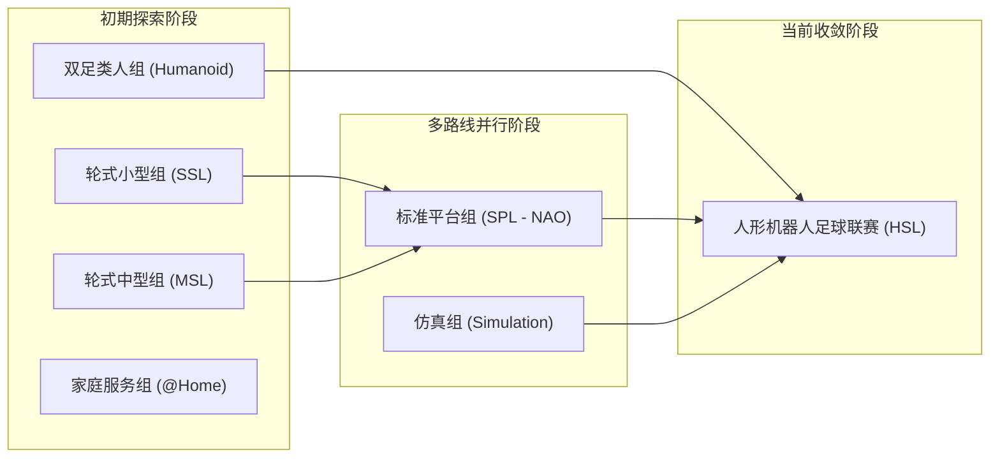
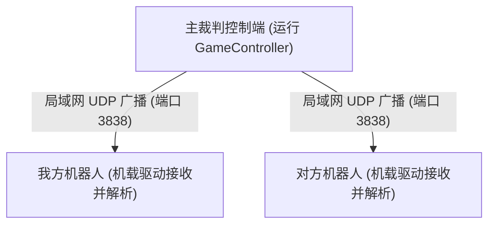

# 1 RoboCup介绍

## 1.1 涵盖有RoboCup的历史（尤其是HSL在近期的更改线路）

### 1.1.1 RoboCup 历史目标与赛事演进
RoboCup（Robot World Cup，机器人世界杯）创立于 1997 年，其设立的长期科学目标为：**“到 2050 年中叶，开发一支完全自主的人形机器人足球队，战胜最近一届的人类男子足球世界杯冠军队。”**

为逐步探索实现路径，RoboCup 设立了多个组别。历经近三十年发展，赛事逐步从轮式底盘、全向轮底盘、统一规格硬件平台过渡到自主双足人形机器人。

### 1.1.2 关键变革路线（聚焦 HSL 方向收敛）
在近期的国际技术委员会（TC）与执行委员会（EC）规则调整中，RoboCup 赛事体系推进了以下整合：
1. **合并 SPL（标准平台组）**：历史上采用 Aldebaran/SoftBank NAO 机器人的标准平台组积累了丰富的定位、视觉、队伍通信与多机器人战术决策实现。随着双足人形硬件的普及，SPL 逐步并入人形足球联赛体系，其优秀的开源软件成果（例如 B-Human）为 HSL 提供了直接的算法参考。
2. **取消 MSL（中型轮式组）**：中型轮式组在全向轮运动控制、全景视觉和高速击球上积累了大量工程方案，但轮式底盘运动特性与双足行走的动力学控制存在本质差异。随着人形机器人动态平衡能力的提高，赛事委员会决定停止 MSL 组别。
3. **取消仿真组与周边分支**：赛事委员会宣布压缩仿真组（Simulation）及部分外围比赛，集中高校与科研团队的研发力量，全面投入到真实物理环境中具有强对抗、高不确定性的人形机器人足球比赛（HSL）。

---

## 1.3 对目前赛事规则简单的介绍

HSL 比赛在标准人工绿茵草皮球场上开展全自主对抗。比赛过程中，所有感知计算、决策逻辑与运动控制必须由机器人机载计算机独立完成。

场地配置包含绿色草皮、白色边界线、中圈、双方禁区以及两个实体球门。机器人通过机载摄像头识别球体、球门立柱与场地交点标线计算相对位置。

### 1.3.1 核心赛制概览
- **赛制规模**：当前全面推进 **7人制标准（7 对 7）**，对抗强度、场地覆盖要求与协同战术复杂度相比以往的 4 对 4 或 5 对 5 大幅提升。
- **比赛时长**：整场比赛分为上下两个半场，**半场有效时长通常为 10 至 15 分钟**（具体以当届赛程公布为准），中场休息 5 至 10 分钟。
- **换人与维修规则**：
  - 参赛队在死球、进球或裁判暂停时，可向主裁判申请换人或将故障机器人移出场地维修（Pick-up）。
  - 离场维修的机器人必须接受至少 30 秒的罚时，且重新入场时必须等待裁判通过 GameController 发送指令并在己方底线规定位置回场，严禁擅自入场。
- **自主性要求**：比赛开始后，除使用无线网络接收裁判盒指令外，严禁任何人工远程遥控机器人。

### 1.3.2 官方规则参考
- **规则整理文档**：[RoboCup 2026 年规则文档（中文整理版）](https://hcnwvqtaepc6.feishu.cn/wiki/PHPCwZCI8iPhDhksyzNcBFKRnIh?from=from_copylink)
- **官方英文最新规则规范**：[HSL-Rules 官方 Rules.pdf 规范](https://github.com/RoboCup-HumanoidSoccerLeague/HSL-Rules/blob/main/Rules.tex)
- **本地归档文件**：参见项目中的 `public-resource/` 目录。
- > [!IMPORTANT]
  > 官方每年都会根据赛事演化更新规则（包括机器人身体比例、足底面积上限、草皮厚度、踢球冲撞判罚标准）。每位研发队员在开展工作前，必须通过 GitHub 官方仓库核实最新规则文本。

---

## 1.4 裁判盒的程序源码

### 1.4.1 GameController（裁判盒）工作原理
GameController（简称 GC）负责全场比赛状态的分发与时间同步。主裁判在场边通过运行 GC 软件发送比赛控制指令，GC 会通过本地局域网向场地内所有机器人的指定 UDP 端口广播状态数据包（RoboCupGameControlData）。

### 1.4.2 核心比赛状态流转
机器人的行为决策必须实时响应 GC 广播的五种核心状态：
1. **INITIAL（初始状态）**：机器人放置在场外，准备入场。
2. **READY（准备状态）**：机器人自主走向开球规定站位。
3. **SET（定位就绪）**：机器人就位静止，等待开球哨声。
4. **PLAYING（比赛进行）**：自由对抗，执行寻球、带球、防守与射门动作。
5. **FINISHED（比赛结束）**：停止主动运动，切换到待机阻尼状态。

除上述五种基础状态外，裁判盒还包含点球惩罚（PENALTY SHOOT）、界外球、任意球以及违规离场（PENALTY_MANUAL）等子状态。

### 1.4.3 源码获取与调试说明
- **官方仓库**：[RoboCup-HumanoidSoccerLeague/GameController](https://github.com/RoboCup-HumanoidSoccerLeague/GameController)
- **本地测试方法**：
  新成员在仿真环境或本地计算机上调试自主决策代码时，可以使用官方提供的 GameController 发送网络广播数据包，配合各队伍开源的客户端驱动程序进行联调测试。
- > [!TIP]
  > 测试前必须确认本队机器人配置的 Team Number 与 Player ID 与 GC 界面完全一致，否则机器人将无法正常接收广播数据。
