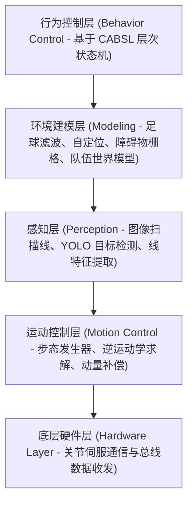

# 1.2 全球历史强队谱系与开源代码

## 1 全球历史强队总览

| 队伍名称 | 所属高校/科研机构 | 国家/地区 | 参赛组别/历史背景 | 核心开源仓库 / 技术文档 | 历史成绩与技术特点 |
| :--- | :--- | :--- | :--- | :--- | :--- |
| **B-Human** | 不来梅大学 / 德国人工智能研究中心 (DFKI) | 德国 | SPL 参赛队 / HSL 参赛队 | [CodeRelease](https://github.com/bhuman/BHumanCodeRelease) / [Docs](https://docs.b-human.de/coderelease2026/) | 10 次以上夺得世界冠军；工程模块化清晰、卡尔曼滤波、快速图像处理、踢球动作生成 |
| **Rhoban FC** | 波尔多大学 (Univ. of Bordeaux) / CNRS | 法国 | KidSize 参赛队 | [Rhoban/RhobanHardware](https://github.com/Rhoban) / [Docs](https://rhoban.com/) | 4 次夺得世界冠军；样条曲线步态规划、逆运动学（IK）求解、笛卡尔空间控制与稳健姿态调整 |
| **NimbRo** | 波恩大学 (Univ. of Bonn) | 德国 | AdultSize / TeenSize 参赛队 | [NimbRo-OP-ROS](https://github.com/AIS-Bonn/nimbro_robotics) | 多届成人组与青少年组冠军；3D 打印人形构型、自主全身动平衡、复杂姿态恢复 |
| **CIT Brains** | 千叶工业大学 (Chiba Inst. of Tech.) | 日本 | KidSize 参赛队 | [citbrains](https://github.com/citbrains) | 多届冠亚军；高精度动力学模型、高刚度关节控制、快速直线射门 |
| **Hephaestus** | 清华大学 (Tsinghua University) | 中国 | KidSize / AdultSize 参赛队 | [TDP 归档文档](https://hsl.robocup.org/qualified-teams/) | 多次进入全球四强；高精度位姿估计、视觉网络轻量化部署、防跌倒控制 |
| **Mountain Sea** | 中国农业大学 (CAU) | 中国 | KidSize / 成人组 参赛队 | [CAU_Mountain_Sea TDP](https://hsl.robocup.org/qualified-teams/) | 长期参赛队伍；精细化步态规划、多传感器信息融合感知 |
| **RoMeLa** | 加州大学洛杉矶分校 (UCLA) | 美国 | AdultSize 参赛队 | [RoMeLa UCLA](https://www.romela.org/) | 研发了 DARwIn-OP 开源平台与 ARTEMIS 高动态本体控制方法 |
| **HERoEHS** | 汉阳大学 (Hanyang University) | 韩国 | AdultSize 参赛队 | [HERoEHS TDP](https://hsl.robocup.org/qualified-teams/) | 亚洲资深参赛队伍，在结构轻量化与机械安全性设计上具备完整规范 |

---

## 2 标杆队伍重点分析与代码参考

### 2.1 B-Human（德国不来梅大学）
B-Human 每年在赛事结束后向全球开源整套参赛系统代码，并附带详细的技术分析报告（Code Release Report）。

- **官方技术文档**：[https://docs.b-human.de/coderelease2026/](https://docs.b-human.de/coderelease2026/)
- **GitHub 开源代码**：[https://github.com/bhuman/BHumanCodeRelease](https://github.com/bhuman/BHumanCodeRelease)
- **环境配置教程**：[https://docs.b-human.de/coderelease2026/getting-started/initial-setup/](https://docs.b-human.de/coderelease2026/getting-started/initial-setup/)
- **阅读重点**：
  - 学习其基于 Blackboard（黑板机制）的数据分发设计与流水线通信方式。
  - 学习其基于样条插值的摆动腿轨迹生成与压力中心（CoP）闭环平衡。
  - 学习其如何将自定位（Self-Localization）计算与队伍通信共享数据结合。

---

### 2.2 Rhoban Football Club（法国波尔多大学）
Rhoban 团队在步态规划与全身动力学控制领域提供了清晰的实现方案：

- **代码结构特点**：
  - **IKWalk 步态发生器**：基于逆运动学解析解的快速参数化步态算法。
  - **Spline 样条控制**：将踢球、起伏、扑救动作参数化为 3 阶或 5 阶多项式曲线。
  - **稳健防跌倒机制**：利用机载 IMU 的角加速度差分快速计算恢复力矩。
- **仓库参考**：[Rhoban Team GitHub](https://github.com/Rhoban)

---

### 2.3 国内重点队伍（清华大学 Hephaestus 与中国农业大学 Mountain Sea）
作为本队国内交流与竞技的主要参考对象，这两支队伍在适应比赛现场光照变化、强化学习步态在国产人形硬件上的部署与调试方面积累了丰富经验。
- 具体内容可查阅归档文件：[CAU_Mountain_Sea-tdp-67d3896715fb9.pdf](file:///f:/RoboCupBook/public-resource/othersTDP/CAU_Mountain_Sea-tdp-67d3896715fb9.pdf) 与 [Tsinghua_Hephaestus-tdp-6788f534a4752.pdf](file:///f:/RoboCupBook/public-resource/othersTDP/Tsinghua_Hephaestus-tdp-6788f534a4752.pdf)。

---

## 3 新成员阅读与分析开源代码的方法

1. **先阅读 TDP 报告，再阅读源码**：各参赛队的 TDP（Team Description Paper）详细说明了整套系统的组成与数据流转，先通读论文有助于掌握全局结构，避免直接查看大量源码时失去方向。
2. **重点分析状态机与接口契约**：首先明确感知模块输出给决策模块的数据结构（通常为足球的局部坐标 $(x,y)$ 与置信度），以及决策模块输出给运动控制模块的目标速度向量 $(v_x, v_y, \omega_z)$。
3. **利用仿真回放日志进行算法验证**：B-Human 与 Rhoban 均支持将真实比赛记录的日志文件在电脑上回放模拟（SimRobot），无需连接实体机器人即可完成算法调试。
