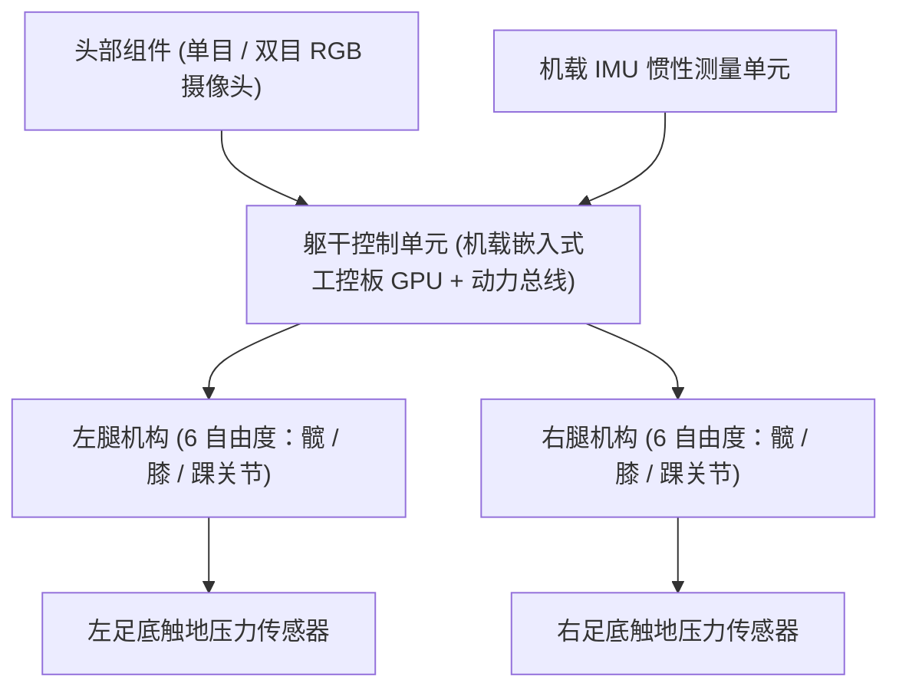

# 2 本队伍介绍的机器人平台和网站平台介绍

## 2.1 T4型号机器人的介绍

当前队伍主要基于中联重科（Zvalley）T4 型号双足人形机器人开展开发与比赛验证。后续新型硬件交付后，系统将针对新构型进行参数适配与程序更新。

### 2.1.1 机器人核心硬件与结构概览
- **机身规格**：
  - 身高处于 60 至 75 cm 范围，全机身采用铝合金与碳纤维复合材料骨架。
  - 采用无刷伺服关节电机，具备应对踢球动作与跨步冲击所需的瞬时扭矩输出能力。
- **计算平台**：机载嵌入式工业控制计算机（如 NVIDIA Jetson 系列），集成 GPU 加速单元，用于运行 YOLO 目标检测模型与步态控制状态机。
- **供电系统**：动力锂电池组，配备独立的低压主板控制电路与高压动力母线断路保护装置。

### 2.1.2 关键传感器与器件深度剖析

#### 1. IMU（惯性测量单元）
- **提供数据**：
  - **3 轴角速度** ($\omega_x, \omega_y, \omega_z$)：以 200 至 1000 Hz 频率检测机身躯干旋转速率。
  - **3 轴线性加速度** ($a_x, a_y, a_z$)：用于重力方向感知与突发碰撞检测。
  - **姿态四元数与欧拉角**（Roll 横滚角, Pitch 俯仰角, Yaw 偏航角）：通过内置扩展卡尔曼滤波（EKF）解算机身绝对朝向姿态。
- **具体用途**：
  - **动平衡闭环调节**：在机器人单腿支撑阶段，利用 Pitch 与 Roll 角度偏差计算躯干姿态倾角，动态调整支撑腿踝关节与髋关节的目标补偿量，维持零力矩点（ZMP）位于足底支撑多边形内部。
  - **跌倒判定与动作恢复**：当 Pitch 或 Roll 倾角超过设定阈值（例如超过 $\pm 45^\circ$ 且角速度异常）时，触发跌倒保护状态，提前释放刚性或进入缓冲姿态；倒地后判定当前朝向为俯卧或者仰卧，自动调用对应的起身动作轨迹。
- **数据订阅方式**：在 ROS 2 中通过标准话题接口（`sensor_msgs/msg/Imu`）进行订阅。

#### 2. 里程计（Odometry）
- **计算机制**：
  - 人形机器人与轮式机器人不同，通常依赖足端运动学与支撑相检测。当判定左脚牢固着地（处于支撑相）时，利用正运动学（Forward Kinematics, FK）根据髋、膝、踝关节各编码器的实际读数，积分计算躯干相对于支撑足的相对平移与旋转。
- **误差特性与数据融合**：
  - 足式里程计在长时间行走、草皮打滑或发生碰撞时会产生累积漂移（Drift）。
  - 里程计位姿通常作为局部相对运动估计输入，必须与视觉感知的场地标线（白线交点、角球点、中圈）通过粒子滤波算法（Monte Carlo Localization）进行全局绝对位置校正。

### 2.1.3 私有说明书与详细硬件手册
T4 型号的硬件电路图、固件通信协议与使用说明属于厂商受限资料，存放在本项目的独立私有仓库中：
- 本地路径：[`Zvalley-resource-old/`](file:///f:/RoboCupBook/Zvalley-resource-old/)（以 Git Submodule 形式管理）
  - `T4小人形机器人使用手册-202604-V1.pdf`
  - `人形机器人使用说明书-v1.2.pdf`
- 仅获得战队内部授权的成员可克隆与查阅私有库中的详细参数。

---

## 2.2 网站平台的介绍

队伍内部部署了赛事资产与数据管理系统，包含以下内容：
1. **比赛记录与多媒体归档**：集中管理历年比赛录像、裁判盒数据包记录（GC Log）及技术讨论记录。
2. **文档沉淀系统**：内部架构讲解演示文稿及新成员技术培训讲义（相关未脱密材料同样存放于私有子模块中）。
3. **软硬件资产台账**：记录每台机器人的舵机使用时长、工控机编号与动力电池充放电循环状态。

---

## 2.3 中联重科 Zvalley 的资源

中联重科为仿生人形机器人提供了配套的软硬件资料与工具：

1. **中联重科开放资料总站**：[https://eai.zvalley.com/openSource](https://eai.zvalley.com/openSource)  
   发布 Zvalley 旗下的固件版本、开发板接口说明与工具链更新。
2. **中联重科 SDK 说明网站**：[SDK 文档中心](https://eai.zvalley.com/openSource/detail/2087512650565427200)  
   说明底层电机通信协议、总线读写接口及传感器驱动程序。
3. **中联重科 SDK-GitHub 网站**：[http://github.com/Zvalley-Robotics/zv_robot_sdk](http://github.com/Zvalley-Robotics/zv_robot_sdk)  
   提供 C++ 与 Python 的官方 SDK 源码，包含完整的示例代码与编译脚本。
4. **Z01 机器人仿真资产网站**：[Z01 仿真模型下载](https://eai.zvalley.com/openSource/detail/2109932634205204480)  
   提供 URDF、MJCF（MuJoCo）与 USD（Isaac Sim）标准刚体惯量、碰撞体积和网格模型，用于开展仿真验证。
5. **Zlab_Gym 开发手册**：[Zlab_Gym 指南](https://eai.zvalley.com/openSource/detail/2109922358609195008)  
   指导如何利用强化学习框架开展人形双足步态与运动控制策略的端到端训练。

---

## 2.4 本队伍的TDP、Video、Robots、Software

本队伍的公开技术成果与参赛资质材料集中归档在项目的 [`public-resource/`](file:///f:/RoboCupBook/public-resource/) 目录下：

### 2.4.1 TDP（Team Description Paper）
- [BigHeroX 2025 TDP (PDF)](file:///f:/RoboCupBook/public-resource/MyTDP/BigHeroX_2025_TDP.pdf)：介绍 2025 赛季的技术方案、机械结构与视觉算法。
- [BigHeroX 2026 TDP (Word / PDF)](file:///f:/RoboCupBook/public-resource/MyTDP/BigHeroX_2026_TDP.pdf)：2026 赛季资格申请报告，重点论述面向 7 对 7 赛制的分布式决策与步态控制。

### 2.4.2 资格赛与实战展示视频（Video）
- **官方审核展示视频**：[BigHeroX 2026 Qualification Video (YouTube)](https://www.youtube.com/watch?v=z3zi2sfMBm4)  
  包含机器人在标准绿茵场地上的自主寻球、带球绕障、单腿踢球射门及倒地自主起身的完整演示。

### 2.4.3 硬件与软件技术明细
- [Robots.pdf](file:///f:/RoboCupBook/public-resource/MyTDP/Robots.pdf)：本队机器人电机选型计算、连杆尺寸参数、重心测量与自由度分配数据表。
- [software.pdf](file:///f:/RoboCupBook/public-resource/MyTDP/software.pdf)：软件工程系统架构图、ROS 2 话题流向拓扑与决策层状态转移图。
- **RoboCup 官方入选队伍公布页面**：[https://hsl.robocup.org/qualified-teams/](https://hsl.robocup.org/qualified-teams/)，集中展示全球所有入围队伍的技术报告。
