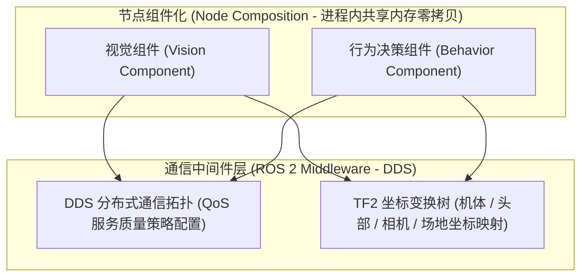
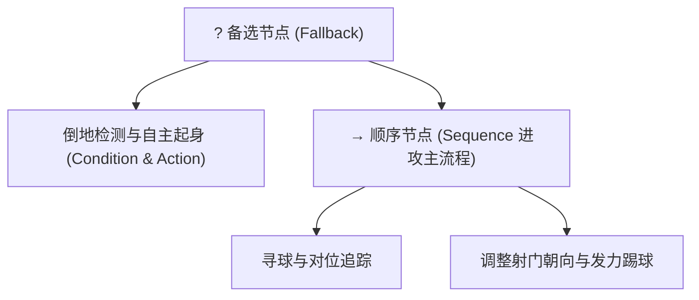

# 3 如何入手学习

> 禁止完全许愿式编程，但也不必转向一行行了解代码，这就像从一个低效走向另一个低效。  
> —— **andinm_hong**

---

## 3.0 必学：Git

对于协同开发而言，版本控制是每个工程师的基础工具。

### 3.0.1 核心要求
1. **基础工作流程**：熟练运用 `git status`、`git diff`、`git commit -m`、`git push`、`git pull --rebase`。严禁随意在公共分支进行强制推送。
2. **分支管理模式**：遵循 Feature 分支规范，通过 Pull Request / Merge Request 进行代码审查与集成。
3. **子模块（Submodule）机制**：本项目将受限硬件手册存放在私有仓库并作为子模块引入。克隆本仓库时需使用递归命令：
   ```bash
   git clone --recurse-submodules https://github.com/RobotWorkShop-BigHeroX/RoboCupBook.git
   ```
4. **实践建议**：新成员建议自己新建若干练习仓库，编写 YAML 工作流运行 GitHub Actions，熟悉自动检查流程。

---

## 3.1 ROS 2 核心特性

ROS 2 是现代机器人软件系统的常用骨架。在机器人足球系统中，重点掌握以下 8 项核心机制：



### 1. DDS / RTPS 通信中间件
- **原理与机制**：去除了 ROS 1 的中心节点管理器（roscore），底层采用工业级 OMG DDS（Data Distribution Service）标准，基于 RTPS 协议实现分布式无中心节点自动发现。
- **比赛场景**：场内某台机器人的机载工控板由于震动重启时，不会导致其他节点通信中断，自动发现机制允许重新连入网络。

### 2. 节点与通信模型
- **Topic（话题）**：单向异步流式数据发布订阅（例如相机每秒 30 帧的图像流）。
- **Service（服务）**：同步双向请求与响应机制（例如向运动控制器下发单次关节标定指令）。
- **Action（动作）**：带有实时进度反馈、支持中途取消的长周期目标任务（例如执行倒地起身动作、移动到指定点球位置）。

### 3. QoS（服务质量策略）
- **核心配置**：
  - `Reliability`：`RELIABLE`（可靠传输，具备重传机制，用于关键比赛状态）对比 `BEST_EFFORT`（尽力传输，低时延，用于高频传感器）。
  - `Durability`：`TRANSIENT_LOCAL`（历史持久化，晚加入的节点也能收到最后一次发布的参数配置）。
  - `History` 与 `Depth`：队列缓冲深度。
- **比赛场景**：IMU 与相机数据通常设置为 `BEST_EFFORT` 配合 `Depth=1`，丢弃过时数据确保低时延；裁判盒比赛状态必须设置为 `RELIABLE`。

### 4. Executor（执行器）与回调调度
- **调度机制**：决定回调函数在哪个线程以何种优先级被唤醒。
  - `SingleThreadedExecutor`：单线程轮询，逻辑简单无锁，但耗时回调会延迟后续控制计算。
  - `MultiThreadedExecutor`：多线程并行调度，高频控制需设置专属 `CallbackGroup`（例如 `Reentrant` 或 `MutuallyExclusive`）。

### 5. Lifecycle Node（生命周期节点）
- **状态流转**：`Unconfigured` $\to$ `Inactive` $\to$ `Active` $\to$ `Finalized`。
- **比赛场景**：在裁判盒处于 `INITIAL` 或 `READY` 状态时，底层电机驱动节点可处于 `Inactive` 仅监听数据；一旦裁判指令切换到 `PLAYING`，批量激活全部感知与步态流水线。

### 6. Node Composition（节点组合）与进程内通信
- 将多个独立节点编译为动态链接库组件（Component），加载到同一个容器进程（Container）中运行。
- **性能优势**：节点之间的数据传递通过指针实现零拷贝（Zero-copy），显著减少图像与点云等大容量内存拷贝开销。

### 7. TF2（坐标变换系统）
- **空间变换树**：维护机器人各连杆在时间维度上的坐标系树结构：
  $$\text{world} \longrightarrow \text{odom} \longrightarrow \text{base\_link} \longrightarrow \text{head\_link} \longrightarrow \text{camera\_link}$$
- **比赛场景**：相机坐标系中检测到的足球局部坐标 $(x_c, y_c, z_c)$，通过 TF 树实时变换为机器人当前坐标系 $(x_b, y_b)$ 以及场地全局坐标系 $(x_w, y_w)$。

### 8. rosbag2（数据录制与回放）
- **复查工具**：在真机对抗测试时录制所有关键话题。返回实验室后使用 `ros2 bag play` 重现测试数据，离线排查丢球、误识别与节点崩溃问题。

---

## 3.2 Linux 常用操作

熟练掌握 Linux 命令行操作是日常开发的基本功。

- **推荐在线学习平台**：[Linux Journey 教程](https://labex.io/LinuxJourney)
- **常用核心命令**：
  - 目录与路径：`pwd`（输出当前绝对路径）、`ls -lh`（查看文件列表详细信息）、`cd`（切换工作目录）
  - 搜索与排查：`find . -name "*.urdf"`（按名称搜索文件）、`grep -rn "QoS" .`（文件内容文本匹配）
  - 监控与追踪：`tail -f run.log`（持续查看日志输出）、`ps aux | grep ros`（检查进程运行状态）
  - 环境与构建：`source /opt/ros/.../setup.bash`（加载环境变量）、`git`（代码版本追踪）、`cmake`（跨平台编译构建工具）

---

## 3.3 视觉检测（YOLO11 与 YOLO26）

机器人足球在复杂光照和场地反光下的目标提取依赖高效轻量的深度学习检测模型。

- **模型版本参考**：
  - **YOLO11**：在嵌入式工控板（例如 Orin Nano / Xavier）上拥有成熟的 TensorRT 部署工具链与算子支持，常用于比赛主力模型。
  - **YOLO26**：结构新颖，适合有算力和兴趣的队员开展前沿精度与速度对比实验。
- **主要用途**：
  - 足球检测（白色球体、黑白斑纹）
  - 球门立柱与横梁检测（白色立柱、门线交界）
  - 对方与己方机器人检测（根据腰间不同颜色的色块标识识别队友与对手）
- **端侧部署关键**：模型需通过 TensorRT 进行 FP16 或 INT8 量化编译为 `.engine` 文件，确保推理时延控制在 15 毫秒以内。

---

## 3.4 行为树和状态机（策略组 重点）

策略组的核心职责是在对抗环境下让多台机器人协调配合。



1. **有限状态机（FSM / HFSM）**：适合处理严格互斥的底层状态流转（例如裁判盒状态响应、单腿跌倒判定）。
2. **行为树（BehaviorTree.CPP）**：具备清晰的模块化与可重用性。通过控制节点（Sequence、Fallback、Parallel）编排条件节点（Condition，如是否看到足球、是否处于己方半场）与动作节点（Action，如执行带球、横向移动、起脚射门）。

---

## 3.5 粒子滤波算法（感知组 重点）

### 3.5.1 规则限制下的定位方案
> [!IMPORTANT]
> **官方竞赛规则严格禁止在人形机器人上安装激光雷达（LiDAR）！** 同时，主动红外深度相机在阳光与绿茵场草皮反射下噪点较大，且在部分规则评审中存在争议。

因此，**机器人的全局自定位主要依赖机载可见光相机与粒子滤波算法（MCL）结合完成。**

### 3.5.2 算法实现核心步骤
1. **粒子群初始化**：在场地坐标系中随机散布代表机器人可能位姿 $(x, y, \theta)$ 的粒子。
2. **运动预测（结合 TF2 与里程计）**：根据足式里程计的运动增量，更新每个粒子的位置。
3. **视觉特征提取**：利用图像算法提取场地特征点（白线交点 L 型角、T 型角、中圈圆弧点、球门左右立柱柱脚点）。
4. **测量更新（权重重采样）**：对比观测特征与已知场地地图之间的几何偏差，给符合当前相机观测的粒子赋予高权重，淘汰低权重粒子。
5. **位姿输出并发布 TF**：粒子收敛后的统计均值即为机器人在全局地图中的绝对坐标，发布为 `map` $\to$ `odom` 的动态坐标变换，消除里程计的累积漂移。

---

## 3.6 深度强化学习（拓展研究方向）

对人形双足步态生成与端到端控制感兴趣的队员，可参考以下知识演进路径：

1. **基础理论**：
   - **Bellman Optimization（贝尔曼最优方程）**：动态规划与值函数迭代的理论前提。
   - **状态价值与动作价值**：状态价值 $V(s)$ 与动作价值 $Q(s, a)$ 关系。
   - **TD（时序差分学习）与蒙特卡洛（Monte Carlo）方法**：采样与时序更新机制。
2. **经典策略算法**：
   - **Policy Network（策略网络）**：直接输出动作概率分布。
   - **Actor-Critic（演员-评论家框架）**：价值网络指导策略网络收敛。
   - **Q-learning 与 DDPG（深度确定性策略梯度）**：连续动作空间下的确定性控制。
   - **PPO（Proximal Policy Optimization，近端策略优化）**：当前在人形双足步态学习中应用广泛的算法（例如在 Isaac Gym / Zlab_Gym 中进行多刚体环境对抗训练）。
