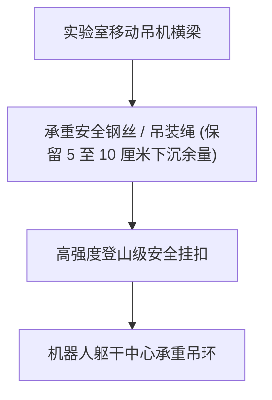

# 5 实验室操作安全守则

参赛人形机器人采用铝合金与碳纤维复合材料骨架，自重达数十公斤。内部高扭矩伺服电机配合高减速比减速器，具备较大的瞬间输出扭矩。在调试与测试过程中，任何程序异常或参数越界都可能引发机体剧烈甩动或设备损伤。所有队员开展真机实验时必须严格遵守安全守则。

---

## 5.1 吊机悬挂与保护规范

1. **全程悬挂吊机**：凡是在实体机器人上进行行走、步态调参、起跳或踢球测试，机器人必须全程牢固挂在安全吊机绳索下方。
2. **吊绳高度调节**：吊绳垂直长度应调节至机器人双足能够贴近地面，同时保留 5 至 10 厘米的自然下沉余量。一旦机器人失去平衡，吊绳能够迅速受力将其悬挂，避免砸在地面损坏机械零件或碰撞人员。
3. **禁止双脚悬空空转**：在机器人处于行走控制算法使能状态下，严禁在关节未处于刚性自锁的情况下直接将机器人双脚悬空。缺少地面反作用力支撑会导致闭环足底压力反馈与步态算法发散，引发关节电机超速运转。

---

## 5.2 三人协作测试制

在实验室进行任何真机动力学测试时，严禁单人私自上电运转。必须遵循三人协作流程：

| 岗位职责 | 人员代号 | 核心任务与安全动作 |
| :--- | :---: | :--- |
| **吊车领航员** | **人员 A** | 双手紧握吊车扶手，视线关注机器人重心，伴随机器人行进平滑推移吊车，随时做好向上拉拽防跌准备。 |
| **遥控主控手** | **人员 B** | 手持无线安全遥控器，拇指放在“一键切阻尼”按键上，高度专注，情况不对立刻按压。 |
| **急停与地面监护员** | **人员 C** | 位于动力电缆与急停按钮（E-Stop）旁，监控测试区域周边人员，记录异常报错信息，必要时拍下急停按钮。 |

---

## 5.3 紧急处置与进入阻尼模式

> [!CAUTION]
> 如果机器人出现危险动作（例如全身剧烈抖动、高频自激振荡、关节大幅扭动），不要犹豫，立刻切入阻尼模式。

### 阻尼模式与直接急停的机理对比
- **阻尼模式（Damping Mode）**：将各电机相线短接或施加低阻尼电流，使所有关节瞬间失去主动驱动力矩，变为带有液压阻尼感的柔顺状态。机器人在吊机拉拽下自然下垂，保护齿轮箱不崩齿。
- **Stop 按钮（急停硬断电）**：直接切断动力母线。在机器人高速甩腿的瞬间如果直接硬断电，巨大惯性可能对减速器齿根产生严重机械冲击。
- **操作准则**：优先执行“情况不对，先切阻尼”；如果阻尼失效或通信中断，果断拍下 Stop 按钮。

---

## 5.4 机器人开机与复位规范

1. **上电前关节手动复位**：
   在接通动力电池或高压母线前，必须先在完全断电状态下，由人工协助将机器人的髋、膝、踝、臂各关节摆正到标定初始零位（Zero Calibration Pose）。
2. **严禁带载开机**：
   严禁在关节扭曲、处于机械死点或足底踩在障碍物上的状态下直接开启总线控制。突然施加的初始目标力矩可能导致机械连杆受到冲击。
3. **低压与高压分离上电**：
   先开启机载计算机与低压逻辑电（确认通信正常、传感器读数稳定），在确认无报错提示后，发出明确口令：“注意，准备接通高压动力！”，再闭合主接触器进入动力测试。
